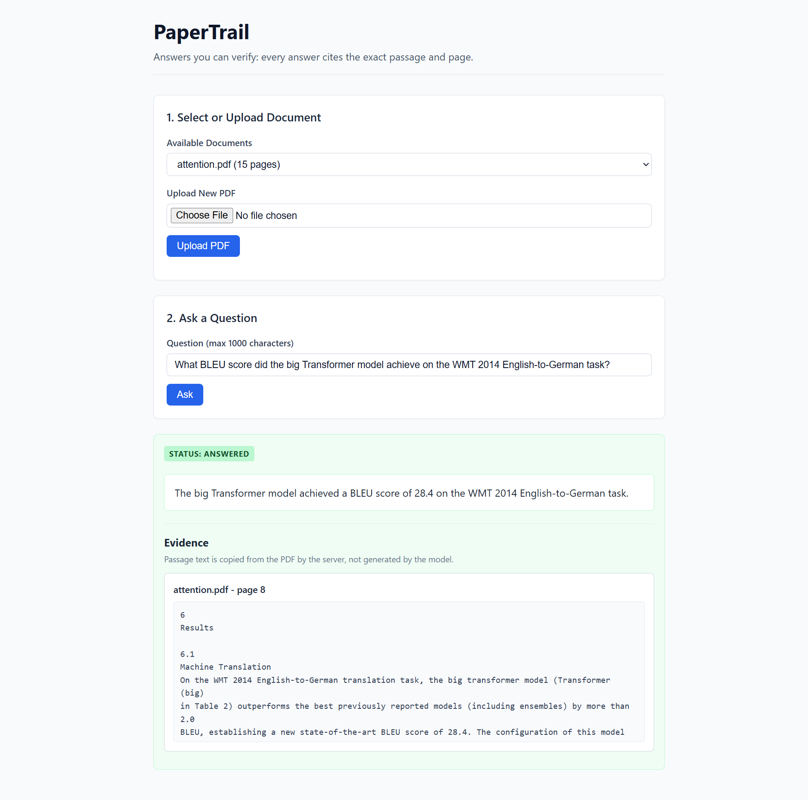
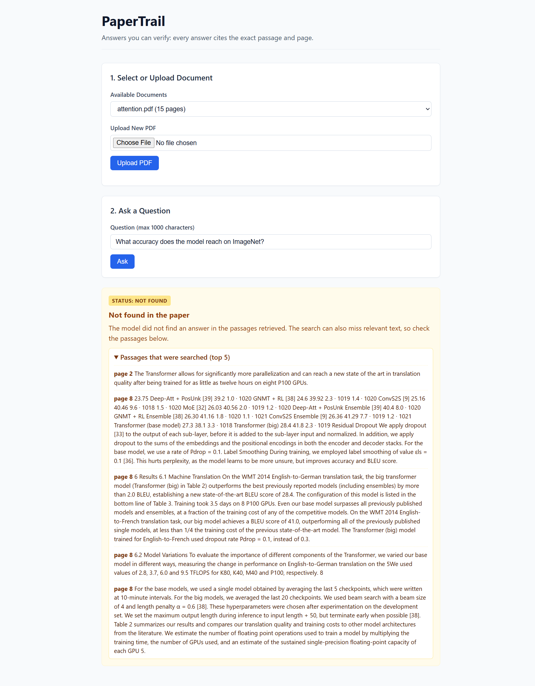

# PaperTrail

Evidence-first question-answering for research papers. Upload a PDF, ask a question in plain English, and receive an answer backed by exact source text passages and 1-based page numbers, or an explicit "not found" refusal when evidence is absent. Reliability and refusal behavior are benchmarked on a labelled test set.

---

## Screenshots


*Answered query: grounded response with server-verified passage text and 1-based page number.*


*Refusal state: explicit notice when passages lack supporting evidence, with inspected candidates.*

---

## UI States

The web interface displays three mutually exclusive response states:
- **`answered`**: Returns model answer text and an Evidence section. Each citation box shows `<filename> - page <page>` and the exact text snippet extracted from the document. Citation page numbers and passage texts are resolved on the server from indexed chunks by passage ID; they are never taken from raw model output.
- **`not_found`**: Clearly formatted banner indicating the model found no sufficient answer in retrieved passages, accompanied by a collapsible list of the top-5 searched passages for human audit.
- **`error`**: Clear banner indicating the model output could not be parsed as valid JSON ("could not read the model's answer", which is distinct from "not found"), prompting the user to retry.

---

## Quick Start

Tested on Windows PowerShell with Python 3.14.

1. **Install dependencies:**
   ```powershell
   pip install -r requirements.txt
   ```

2. **Configure environment variables:**
   ```powershell
   $env:GEMINI_API_KEY = "<your key>"
   $env:GEMINI_MODEL = "gemini-3.5-flash-lite"
   ```

3. **Launch the server:**
   Must be executed from the project root because the LLM response cache (`.cache/llm/`) is stored relative to the current working directory:
   ```powershell
   python -m uvicorn src.api:app --port 8000
   ```

4. **Access the application:**
   Open [http://127.0.0.1:8000/](http://127.0.0.1:8000/) in any modern web browser.

---

## REST API

All routes implemented in `src/api.py`:

| Method | Path | Status Codes | Description |
|---|---|---|---|
| `GET` | `/` | `200`, `404` | Serves `static/index.html`. Returns `404` if file is missing. |
| `GET` | `/health` | `200` | Returns `{"status": "ok"}`. |
| `POST` | `/documents` | `201`, `400`, `413`, `422` | Multipart upload (field `"file"`). Validates `%PDF-` magic bytes, streams up to 25 MB, ingests text chunks. Returns `400` on non-PDF bytes or corrupt files, `413` if size exceeds limit, `422` if PDF has no text layer. |
| `GET` | `/documents` | `200` | Lists all ingested documents with `doc_id`, `filename`, `total_pages`, `chunk_count`. |
| `GET` | `/documents/{doc_id}` | `200`, `404` | Returns metadata for a single document. Returns `404` if unknown. |
| `POST` | `/documents/{doc_id}/ask` | `200`, `404`, `422`, `502`, `503` | Accepts JSON `{"question": "..."}`. Returns `200` with status `answered`, `not_found`, or `error`. Returns `404` for missing doc, `422` for invalid question (empty or >1000 chars), `503` if LLM is unreachable or unconfigured, `502` on upstream request failure. |

---

## Key Design Decisions

- **Strict 1-Based Page Numbers**: PyMuPDF indexes 0-based; PaperTrail normalizes all pages to physical 1-based indexing (`page_number = page_idx + 1`) across extractors, chunks, and citations.
- **Page-Bounded Chunking**: Chunks never cross physical page boundaries, ensuring unambiguous citations. Chunks follow the identifier convention `<doc>::p<page>::c<index>`, merging short paragraphs (<60 chars) and splitting long ones (>1000 chars).
- **BM25 as Default Retriever**: Okapi BM25 (`rank_bm25`) serves as the primary retriever. While dense (`bge-small-en-v1.5`) and hybrid (RRF $k=60$) implementations are available, BM25 demonstrated the strongest retrieval recall on benchmark testing.
- **Frozen Benchmark Dataset**: System performance is measured against `eval/dataset_all.json` (66 items).

---

## Command-Line Tools

The CLI entrypoint `src/cli.py` provides standalone extraction, search, and retrieval without running the web server:

```powershell
# Extract metadata and preview page snippets
python -m src.cli papers/attention.pdf

# Display entire extracted text per page
python -m src.cli papers/attention.pdf --full-text

# Preview specific character count per page
python -m src.cli papers/attention.pdf --preview-chars 300

# Case-insensitive keyword and phrase search
python -m src.cli papers/attention.pdf --search "positional encoding"

# Ranked BM25 retrieval for top matching passages
python -m src.cli papers/attention.pdf --retrieve "attention heads" --top-k 5
```

---

## Milestones

| Milestone | Scope & Deliverables | Report |
|---|---|---|
| **M1** | PDF text extraction, 1-based page metadata, blank page handling | *(initial baseline)* |
| **M2** | Case-insensitive keyword and phrase search across pages | [MILESTONE_2_REPORT.md](MILESTONE_2_REPORT.md) |
| **M3** | Page-bounded passage chunking, BM25 ranked retrieval, IR evaluation harness | [MILESTONE_3_REPORT.md](MILESTONE_3_REPORT.md) |
| **M3.5** | Trustworthy benchmark harness, multi-paper evaluation expansion | [MILESTONE_3_5_REPORT.md](MILESTONE_3_5_REPORT.md) |
| **M4** | Dense vector retrieval (`bge-small`), hybrid RRF ($k=60$), comparative audit | [MILESTONE_4_REPORT.md](MILESTONE_4_REPORT.md) |
| **M5** | Evidence-grounded QA generation, refusal enforcement, Gemini client | [MILESTONE_5_REPORT.md](MILESTONE_5_REPORT.md) |
| **M6** | LLM-as-a-judge answer & citation verification, error analysis | [MILESTONE_6_REPORT.md](MILESTONE_6_REPORT.md) |
| **M6.5** | Table-aware chunking experiment (evaluated and discarded; chunker unchanged) | [MILESTONE_6_5_REPORT.md](MILESTONE_6_5_REPORT.md) |
| **M7** | FastAPI service layer, hardened REST API, vanilla HTML/CSS/JS frontend | [MILESTONE_7_REPORT.md](MILESTONE_7_REPORT.md) |
| **M8** | Reranker experiment (BM25 top-20 + cross-encoder): evaluated, not adopted | [MILESTONE_8_REPORT.md](MILESTONE_8_REPORT.md) |

---

## Evaluation Benchmark

Evaluated on the frozen benchmark `eval/dataset_all.json` (66 items across `attention.pdf`, `bert.pdf`, and `drs.pdf`):

- **Retrieval Performance (Passage R@1 / R@3 / R@5)**:
  - BM25: **44.4%** / **71.1%** / **73.3%**
  - Hybrid (RRF $k=60$): 42.2% / 60.0% / 68.9%
  - Dense (`bge-small-en-v1.5`): 24.4% / 44.4% / 62.2%
- **Answer Generation (`gemini-3.5-flash-lite`, BM25 top-5)**:
  - Refusal on unanswerables: **19 / 21** (90.5% true refusal rate)
  - False refusals on answerables: **7 / 45** (15.6%; 6 were caused by retrieval misses)
  - Citation validity: **40 / 40** (all citations cited real candidate pool IDs)
- **Judge Verification (M6, 50 citations across 40 answers)**:
  - Verifier breakdown: **43 supported**, **4 partially supported**, **3 not supported**
  - Independent blind validation: automated judge matched blind labels on **11 of 14** items

---

## Project Layout (key files)

```text
eval/dataset_all.json         # 66-item frozen evaluation benchmark
eval/heldout_tables.json      # 15-item table evaluation dataset
eval/results/                 # Timestamped evaluation run outputs
papers/attention.pdf          # Attention Is All You Need paper
papers/bert.pdf               # BERT pre-training research paper
papers/drs.pdf                # Deep positional encoding (ResNet) paper
scripts/compare_runs.py       # Comparative analysis between retrieval runs
scripts/run_answer_eval.py    # Answer generation evaluation harness
scripts/run_eval.py           # Retrieval metric evaluation harness
scripts/run_verify_eval.py    # LLM-as-a-judge citation verification script
src/answerer.py               # RAG prompt construction & answer parser
src/api.py                    # FastAPI application, route handlers, hardening
src/chunker.py                # Page-bounded passage chunking engine
src/cli.py                    # Standalone command-line extraction & search
src/dense_retriever.py        # Vector embeddings retriever with disk caching
src/extractor.py              # PyMuPDF text extractor & page normalizer
src/hybrid_retriever.py       # Reciprocal Rank Fusion hybrid search engine
src/llm_client.py             # Gemini API client with caching and backoff
src/metrics.py                # Information retrieval metrics (Recall@k, MRR)
src/retriever.py              # Okapi BM25 ranked retrieval engine
src/search.py                 # Keyword search and passage splitting
src/service.py                # In-memory document store & orchestration service
src/verifier.py               # LLM verification rules & judge prompts
static/index.html             # Zero-dependency vanilla HTML/JS frontend
tests/conftest.py             # Pytest fixtures and synthetic test PDFs
tests/test_api.py             # Unit tests for core REST endpoints
tests/test_api_ask.py         # Unit tests for question-answering endpoints
tests/test_api_hardening.py   # Security tests for upload and error handling
tests/test_api_static.py      # Tests for static HTML delivery
```

---

## Known Limitations

- **Volatile Storage**: Documents reside in an in-memory store and do not persist across server restarts.
- **Local Single-Process Demo**: Designed without user authentication or rate-limiting per client; not intended for public deployment without an API gateway.
- **Evaluation Scope**: System tested and benchmarked across 3 academic papers.
- **Retrieval Ceiling**: Passage Recall@5 is approximately 73.3%, meaning certain answerable queries are refused because relevant text ranks outside the top 5 (for instance, the base Transformer model's attention heads count in `attention.pdf`).(73.3% is the automated phrase-match metric; a manual audit in MILESTONE_5_REPORT.md found supporting text in the top 5 for at least 38 of 45 answerable items.)
- **Table Flattening**: PyMuPDF flattens two-dimensional table structures into sequential text streams, which can dissociate row headers from column values.
- **Free-Tier LLM Quotas**: Gemini free-tier keys have strict rate limits; concurrent queries may return HTTP 503.
- **Offline Judge**: The Milestone 6 verification engine is an evaluation diagnostic and is not wired into the live API serving path.
- **Digital PDF Requirement**: Image-only scans without OCR text layers yield empty text (`has_text = False`).

---

## Tests

Test suite runs completely offline without network access:

```powershell
python -m pytest -q
```

Result: **196 passed**, 1 warning.
